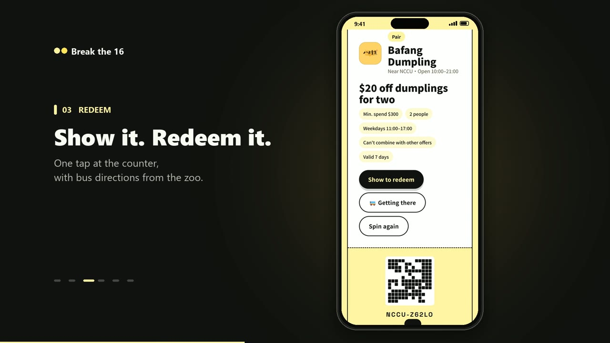

# 破局十六週 · Break the 16

**政大商圈跨域引流 × 假期飯友**　|　NCCU Food Street × Holiday Meal Buddies

🔗 **網站：<https://dennis-tw.com/management/>**



## 摘要

學期縮短為十六週後，寒暑假變長，學生一離開，政大周邊商圈就跟著冷清。
「破局十六週」用兩條路把人帶回指南路：

1. **轉盤優惠券**：動物園遊客掃 QR Code 進站，選擇一人、二人或多人，轉出一張政大商圈合作店家的優惠券。券上有最低消費、適用時段與人數，並附核銷畫面與從動物園搭公車過來的交通指引。
2. **心動鈴（假期飯友）**：留校生、外籍生與附近居民填寫用餐日期、時段、預算與口味，按下心動鈴登記。網站會依口味推薦店家，團隊再幫大家湊成一桌。

網站支援中英切換，以手機瀏覽為主要設計，並附一個需要金鑰才能進入的後台，用來查看心動鈴報名與優惠券發放、核銷的數據。

## Summary (English)

Shorter 16-week semesters mean longer holidays, and the food street around National Chengchi University (NCCU) goes quiet. *Break the 16* brings people back in two ways:

- **Coupon wheel**: zoo visitors pick their party size and spin for a deal at a local shop. Each coupon has a redeem screen and bus directions from the zoo.
- **Meal Bell**: students and locals who stay over the holidays set a date, budget and food preference to be matched into a shared table.

The site is bilingual (中文 / English), mobile-first, and has a key-protected admin dashboard.

## 功能一覽

| 頁面 | 內容 |
| --- | --- |
| 首頁 `index.html` | 循環小動畫（會眨眼的角色、載著動物的公車）＋ 轉盤優惠券 |
| 為什麼做這個 `why.html` | 問題背景與解法 |
| 心動鈴 `bell.html` | 飯友媒合報名表，送出後推薦符合口味的店家 |
| 合作店家 `shops.html` | 12 間政大商圈店家，可依類別篩選並查看各人數方案 |
| 關於我們 `about.html` | 團隊介紹與聯繫方式 |
| 後台 `admin.html` | 心動鈴與優惠券數據、圖表與 CSV 匯出（需 `ADMIN_KEY`） |

> 合作店家與優惠內容目前為模擬資料，實際合作以店家確認為準。

## 技術架構

- **前端**：純 HTML / CSS / JavaScript，不需框架。共用的頁首、頁尾與中英文字串都在 `site/app.js`。
- **後端**：Netlify Functions
  - `POST /api/track`：驗證並儲存心動鈴報名與優惠券事件
  - `GET /api/admin`：用 `x-admin-key` 驗證後回傳所有數據
- **資料**：Netlify Blobs（store `events`）
- **部署**：Netlify 網站 `nccu-po-ju-16`，透過 dennis-tw.com 的轉址規則對外提供於 `/management/`

```
site/               靜態網站（實際部署的檔案）
src/                子頁內容範本，由 build.py 包成 site/*.html
netlify/functions/  後端 API
video/              產生展示影片的錄影與合成腳本
docs/               README 用圖片
```

## 本機開發與部署

```bash
# 修改 src/*.html 後重新產生子頁
python build.py

# 本機預覽（後端 API 需在 Netlify 上才會運作）
python -m http.server 5178 -d site

# 部署到 Netlify
npm install
netlify deploy --prod --dir site --functions netlify/functions
```

後台金鑰請在 Netlify 環境變數設定 `ADMIN_KEY`，不要寫進程式碼。

> ⚠️ 站內連結必須保持相對路徑，網站才能在 `/management/` 子路徑下正常運作；Netlify 的 Pretty URLs 需保持關閉。

## 聯繫

我們是來自國立政治大學的一個小團隊。
蕭志紘 · 0905116999
